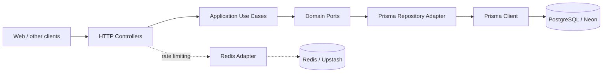

# Telurify API Nest

[](https://nestjs.com/)
[](https://www.typescriptlang.org/)
[](https://www.prisma.io/)
[](https://www.postgresql.org/)
[](https://www.docker.com/)
[](https://nodejs.org/)
[](LICENSE)

Backend API for Telurify built with **NestJS**, **TypeScript**, **Prisma**, and **PostgreSQL**.

## Purpose

The API exposes seismic activity stored in PostgreSQL and provides the following capabilities:

- Query paginated seismic events.
- Filter events by magnitude type and magnitude range.
- Filter events by date range.
- Filter events by tsunami status.
- Query aggregate statistics.
- Receive user intensity reports.
- Register web notification devices.
- Manage devices through a protected administrative token.


## Project Status

The following modules are currently implemented:

- Seismic events.
- Statistics.
- Reports.
- Devices.
- Administrative authentication through `X-Admin-Token`.
- PostgreSQL persistence through Prisma.
- Docker development and production images.
- CORS configuration.

Distributed Redis-backed rate limiting and automated contract tests are part of the next compatibility phase with Rails.

## Architecture

The project follows a pragmatic hexagonal architecture. NestJS is used as the HTTP delivery and dependency-injection framework, while application use cases remain independent from HTTP concerns.



### Layers

| Layer | Responsibility |
|---|---|
| `presentation` | HTTP controllers, parameters, status codes, and response serialization. |
| `application` | Use cases and operation coordination. |
| `domain` | Internal ports and contracts independent from Prisma and Express. |
| `infrastructure` | Concrete implementations for PostgreSQL and external services. |
| `shared` | Cross-cutting services such as configuration and Prisma. |

## Project Structure

```text
src/
├── modules/
│   ├── devices/
│   ├── reports/
│   └── sismos/
│       ├── application/
│       ├── domain/
│       ├── infrastructure/
│       └── presentation/
├── shared/
│   └── database/
├── app.module.ts
└── main.ts
prisma/
└── schema.prisma
Dockerfile
Dockerfile.dev
docker-compose.yml
```

## Requirements

- Docker and Docker Compose.
- Node.js 24 only when running commands outside Docker.
- A local PostgreSQL instance or a Neon connection.
- Redis when distributed rate limiting is enabled.

## Configuration

Create the local environment file:

```bash
cp .env.example .env
```

Main variables:

| Variable | Description |
|---|---|
| `PORT` | API HTTP port. The parallel development port is `3001`. |
| `DATABASE_URL` | Full PostgreSQL or Neon connection URL. |
| `DOCKER_DATABASE_URL` | PostgreSQL URL used when the API runs inside Docker. |
| `POSTGRES_HOST` | PostgreSQL host retained from the Rails configuration. |
| `POSTGRES_PORT` | PostgreSQL port. |
| `USER_DB` | PostgreSQL username. |
| `PASSWORD_DB` | PostgreSQL password. |
| `ADMIN_TOKEN` | Token required to list and delete devices. |
| `REDIS_URL` | Redis connection URL. |
| `RACK_ATTACK_REDIS_URL` | Dedicated rate-limiting Redis URL. |
| `ALLOWED_ORIGIN` | Allowed CORS origin. |

`DATABASE_URL` takes precedence for Prisma. The `POSTGRES_*` variables are retained to keep the configuration names compatible with the Rails environment.

When NestJS runs directly on the host machine, use `localhost` in `DATABASE_URL`. When it runs inside Docker and connects to the PostgreSQL container exposed by the Rails Compose stack, use `host.docker.internal` in `DOCKER_DATABASE_URL`. A Neon URL can be used for both variables.
> [!IMPORTANT]
> Never commit `.env` files or real credentials.

## Local Docker Development

The existing Rails API uses port `3000`. This API uses port `3001` so both services can run in parallel.

```bash
docker compose up --build
```

The API is available at:

```text
http://localhost:3001
```

Test endpoint:

```bash
curl 'http://localhost:3001/v1/sismos?page=1&per_page=10'
```

Stop the service:

```bash
docker compose down
```

Source changes are reflected through hot reload because the project is mounted as a volume. Prisma is regenerated automatically when the container starts to prevent stale generated clients in the persistent `node_modules` volume.

## Running Without Docker

Install dependencies:

```bash
npm install
npx prisma generate
```

Start development mode:

```bash
npm run start:dev
```

The local PostgreSQL container must be running first:

```bash
docker compose up -d db backend
npm run start:dev
```

Type-check and build:

```bash
npm run typecheck
npm run build
```

## Prisma and the Database

The database already exists and is shared with other services. Therefore, this project must not run destructive migrations or initially assume ownership of the schema.

To update the local Prisma model from an existing database:

```bash
npx prisma db pull
npx prisma generate
```
> [!IMPORTANT]
> Do not run `prisma migrate dev` or `prisma migrate reset` against a shared database.

## Endpoints

All endpoints use the `/v1` prefix.

### Seismic Events

```http
GET /v1/sismos
GET /v1/sismos/stats
```

Pagination parameters:

- `page`: current page, defaults to `1`.
- `per_page`: result count, with a maximum of `1000`.

Nested filters:

- `filters[mag_type]`: comma-separated magnitude types.
- `filters[mag_min]`: minimum magnitude.
- `filters[mag_max]`: maximum magnitude.
- `filters[date_from]`: start date.
- `filters[date_to]`: end date.
- `filters[tsunami]`: `true`, `false`, `1`, `0`, `t`, or `f`.

Example:

```bash
curl 'http://localhost:3001/v1/sismos?page=1&per_page=10&filters[mag_type]=mw,ml&filters[mag_min]=2'
```

The public response structure is compatible with Rails:

```json
{
  "data": [],
  "pagination": {
    "current_page": 1,
    "total": 0,
    "per_page": 10
  }
}
```

### Reports

```http
POST /v1/sismos/:sismo_id/reports
```

Example:

```bash
curl -X POST 'http://localhost:3001/v1/sismos/1/reports' \
  -H 'Content-Type: application/json' \
  -d '{"felt":true,"intensity":"moderate"}'
```

Valid `intensity` values:

```text
not_felt, weak, light, moderate, strong, severe
```

### Devices

Register a device:

```http
POST /v1/devices
```

```bash
curl -X POST 'http://localhost:3001/v1/devices' \
  -H 'Content-Type: application/json' \
  -d '{"fcm_token":"token-from-firebase-messaging"}'
```

List devices:

```http
GET /v1/devices
```

Delete a device:

```http
DELETE /v1/devices/:id
```

Administrative operations require:

```http
X-Admin-Token: <ADMIN_TOKEN>
```

## Rails Compatibility

Migration validation is performed by running both APIs at the same time:

| Service | URL |
|---|---|
| Rails | `http://localhost:3000` |
| NestJS | `http://localhost:3001` |

Each endpoint should be compared for:

- HTTP status code.
- JSON structure.
- Field names.
- Pagination behavior.
- Validation errors.
- Authentication behavior.
- Missing-resource behavior.

## Testing and Quality Checks

```bash
npm run typecheck
npm run build
```

Docker images can be built with:

```bash
docker build -f Dockerfile.dev -t telurify-api-nest:development .
docker build -f Dockerfile -t telurify-api-nest:production .
```

## License

This project is distributed under the MIT License. See [`LICENSE`](LICENSE).
